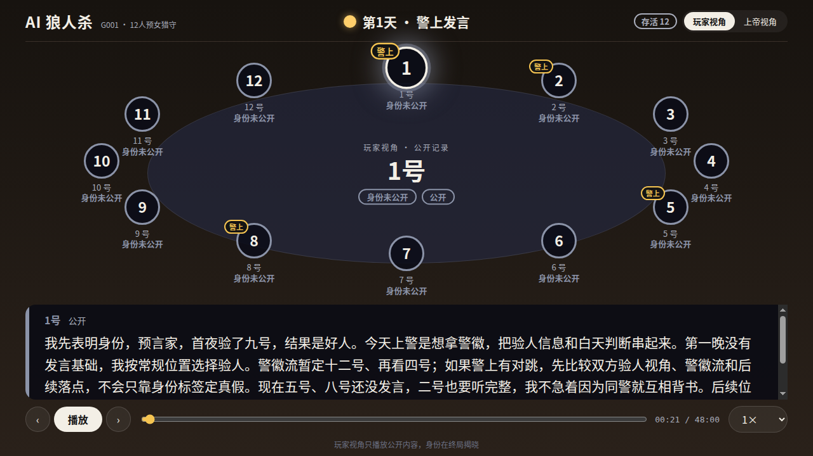

# AI 狼人杀

[English](README.en.md) | 中文

12 个 AI 玩家打一局 12 人预女猎守，由一个 AI 上帝主持，打完自动配音，并生成可以切换上帝视角和玩家视角的回放和视频。

你只需要对 lead 说一句「开一局狼人杀」，再回答一次配置确认。之后的组队、建群、主持、配音和出视频都由 agent 自己完成，中途不用人盯。项目基于 [agt](https://github.com/blacsheep/agt)。

[](docs/demo.mp4)

[▶ 观看带语音的精华剪辑](docs/demo.mp4)（3 分钟，上帝视角）：首夜狼队商量刀口，一号狼人悍跳预言家拿下警徽，真预言家五号被放逐，最后狼人阵营获胜。

## 有什么不一样

- **上帝也是 agent。** 上帝负责点名、宣布死讯、组织警选和放逐，用的是和玩家同一套的群聊和私聊。规则由引擎裁决，上帝只能依据引擎返回的结果主持。
- **每个座位只能看到自己的信息。** 每名玩家只挂自己座位的 MCP（`ww-p01` … `ww-p12`），拿不到别人的身份和夜间行动。上警、退水和投票都是先向引擎提交，再私聊告诉上帝，由上帝统一公布，公共群里不会出现一圈「我上警」。
- **对局可以审计和复盘。** 引擎把每个动作写进带哈希链的事件日志，身份由记录在日志里的种子分配。回放和视频都按日志重算状态，不按模型说的话推断。
- **可以多家模型同台。** 每个座位可以用不同厂商的模型，终局时揭晓每个座位用的是哪个模型。
- **产出可以直接看。** 每局生成整局语音、带字幕和座位高亮的网页回放（可切换上帝视角和玩家视角），以及和整局音频等长的上帝视角 mp4。



## 一局是怎么跑起来的

```text
你 ──「开一局狼人杀」──▶ lead（skill: werewolf-game，用 goal 跟踪到完成）
                          │
                          ├─ runner：建对局目录 games/gNNN 和座位表 seats.json
                          ├─ 创建上帝和 12 名玩家，建公共群，开局
                          │     上帝 ⇄ 引擎 MCP ww-god
                          │     玩家 ⇄ 各自的 MCP ww-pXX
                          ├─ runner：tools/tts → transcript.json、audio/full.mp3、timeline.json
                          └─ runner：tools/replay → replay/index.html、replay/god.mp4
```

一局对话部分大约要两个小时（实测：13 个座位都用同一个推理模型），配音和出视频再要几十分钟。

## 准备

支持 Linux 和 macOS。所有 agent 都用你在 agt 里配置的模型，不需要另装 Codex 或 Claude Code。

| 依赖 | 用来做什么 |
| --- | --- |
| [agt](https://github.com/blacsheep/agt) ≥ 0.6.1 | 运行所有 agent：lead、上帝、12 名玩家和 runner，以及群聊、任务和 Web 控制台 |
| Python 3.10+ | 运行规则引擎（只用标准库）和 setup 脚本 |
| [uv](https://docs.astral.sh/uv/) | 运行配音和回放工具，按需拉取它们用的 edge-tts、numpy、Pillow，不装进系统 Python |
| ffmpeg | 把每句配音拼成整局音频，把回放画面编码成 mp4 |
| Google Chrome 或 Chromium（可选） | 回放网页的自动验收（`tools/replay/verify_browser.py`）和录屏脚本；正常开一局用不到 |
| Noto Sans CJK 字体 | 在回放视频的画面上画中文 |
| 至少一个支持工具调用的模型 API | agent 的大脑；key 填在 `models.env` 里，见下面的快速开始 |
| 能访问微软 edge-tts 服务的网络 | 给每句话配音 |

内存建议 4 GB 以上。

### Linux（Debian/Ubuntu）

```bash
# agt：预编译的单个程序，装到 ~/.local/bin。已经装过旧版的话，重跑这条就会升级
curl --proto '=https' --tlsv1.2 -LsSf https://github.com/blacsheep/agt/releases/latest/download/agt-cli-installer.sh | sh

# uv：配音和回放工具靠它运行
curl -LsSf https://astral.sh/uv/install.sh | sh

# Python（引擎）、ffmpeg（音视频）、中文字体（视频画面）
sudo apt install python3 ffmpeg fonts-noto-cjk

# 可选：Google Chrome（回放验收和录屏）。下载官方安装包再装
wget https://dl.google.com/linux/direct/google-chrome-stable_current_amd64.deb
sudo apt install ./google-chrome-stable_current_amd64.deb
```

### macOS

先装好 [Homebrew](https://brew.sh)，下面的依赖都用它装。

```bash
# agt：预编译的单个程序，装到 ~/.local/bin。已经装过旧版的话，重跑这条就会升级
curl --proto '=https' --tlsv1.2 -LsSf https://github.com/blacsheep/agt/releases/latest/download/agt-cli-installer.sh | sh

# Python（引擎）、uv（配音和回放工具）、ffmpeg（音视频）
brew install python uv ffmpeg

# 中文字体（视频画面）
brew install --cask font-noto-sans-cjk

# 可选：Google Chrome（回放验收和录屏）
brew install --cask google-chrome
```

回放如果提示找不到中文字体，用 `WW_FONT`、`WW_FONT_BOLD` 指向字体文件；Chrome 不在默认位置时，用 `CHROME` 指向浏览器程序。

### Windows

暂不支持。规则引擎依赖 Windows 没有的文件锁和安全文件接口（`fcntl`、`O_NOFOLLOW`、目录 fd），脚本也都是 bash。

## 快速开始

```bash
git clone https://github.com/blacsheep/werewolf-game && cd werewolf-game
export AGT_HOME="$PWD/.agt"          # 或者用 direnv 加载 .envrc

cp models.env.example models.env     # 填一个或多个厂商的地址、key 和模型名
scripts/setup-models.sh              # 每个填好的厂商生成一个同名的 agt 模型，比如 claude
scripts/setup-team.sh claude         # lead 和 runner 用这个模型，它也是上帝和玩家的默认模型
scripts/console.sh &                 # 启动 Web 控制台，地址写在 recording/console.log
```

`models.env` 在 `.gitignore` 里，key 只保存在你本机的 agt provider 里，不会进仓库。`.agt/` 里的东西全部由 setup 脚本按本机路径生成，也不进仓库。

打开控制台，私聊 lead，说「开一局狼人杀」。lead 会用一条消息和你对齐以下几项，回复「默认」就直接开跑：

1. 对局编号：默认自动选下一个未用的编号。
2. 每个座位用哪个模型：默认上帝和 12 名玩家都用 lead 的模型，也可以逐个座位指定。
3. 板子：目前只支持 12 人预女猎守，规则见 [docs/rules.md](docs/rules.md)。
4. 要哪些产出：默认语音、回放和视频都要。
5. 其他要求，比如玩家风格、解说语气。

跑完后，lead 会汇报胜方、全员身份、产出路径和语音核验结果。想再来一局，还是说同一句话。

## 每局的产出

| 文件 | 内容 |
| --- | --- |
| `games/<局>/events.jsonl` | 引擎事件日志（哈希链），对局的唯一事实来源 |
| `games/<局>/seats.json` | 每个座位的成员和模型 |
| `games/<局>/transcript.json` | 合并后的全部发言：公共群、狼队群、私聊、旁白 |
| `games/<局>/audio/full.mp3` | 整局语音 |
| `games/<局>/timeline.json` | 每句话在音频里的起止时间 |
| `games/<局>/replay/index.html` | 网页回放，用浏览器直接打开 |
| `games/<局>/replay/god.mp4` | 上帝视角视频 |

[examples/sample-game](examples/sample-game) 是一局完整对局（狼人第 4 天获胜）的事件日志、座位表、发言记录和时间线，不用跑模型也能看一局是怎么打的。

也可以不经过 agent，手动重做语音和回放：

```bash
tools/tts/run.sh --public <公共群 ID>
uv run --with pillow python tools/replay/build.py --game games/g001
```

细节见 [engine/README.md](engine/README.md)、[tools/tts/README.md](tools/tts/README.md) 和 [tools/replay/README.md](tools/replay/README.md)。

## 目录

```text
engine/              规则引擎：一个 MCP 服务器，每个座位一个锁定实例
prompts/             上帝、玩家和 runner 的提示词
docs/rules.md        板子和规则，引擎和所有 agent 都以它为准
docs/playbook.md     玩家打法资料
docs/skills/         lead 用的 werewolf-game，玩家用的 ww-playbook
docs/brief.md        搭建这个项目时分阶段发给 lead 的原始需求
tools/tts/           配音：整理发言、edge-tts 合成、拼接、核验
tools/replay/        回放：网页、公开音轨、上帝视角 mp4
scripts/             初始化、控制台、录屏
examples/            示例对局
```

## 测试

```bash
python3 -m unittest discover -s engine/tests
uv run --no-project --with numpy python3 -m unittest discover -s tools/tts/tests
cd tools/replay && uv run --no-project --with pillow python -m unittest test_replay
```

这些测试都不联网，也不调用模型。回放测试要用一局带整局音频的完整对局，默认是 `games/current`，没有就跳过；也可以用 `WW_REPLAY_GAME` 指定。

## 录屏（可选）

```bash
uv run --with playwright python scripts/record.py --name run1   # 每 3 秒截一张控制台
echo <会话 ID> > recording/focus                                  # 切换到某个会话
touch recording/stop                                               # 停止
scripts/make-video.sh run1                                         # 合成加速的 mp4 和 webp
```

## 已知限制

- 只有一个板子。换板子要改引擎、规则文件和提示词。
- edge-tts 调用的是微软的在线朗读服务，不是官方开放的 API，随时可能限流或变更。普通话音色只有 11 个，部分座位只能靠调整音调和语速来区分。
- 模型偶尔不按规则说话，比如发言超长或私下拉群。引擎会拒绝不合法的动作，但管不了模型说什么。
- 一局的模型调用量很大：每个座位的每次发言、投票和夜间行动都会调用模型，上帝每一步也会调用。开跑前请先估算你所用模型的费用。

## 这个项目本身也是 agent 写的

引擎、配音和回放工具都是 agt 里的编码 agent 按 [docs/brief.md](docs/brief.md) 分阶段写出来的，人只负责提需求和验收。

## License

[MIT](LICENSE)
